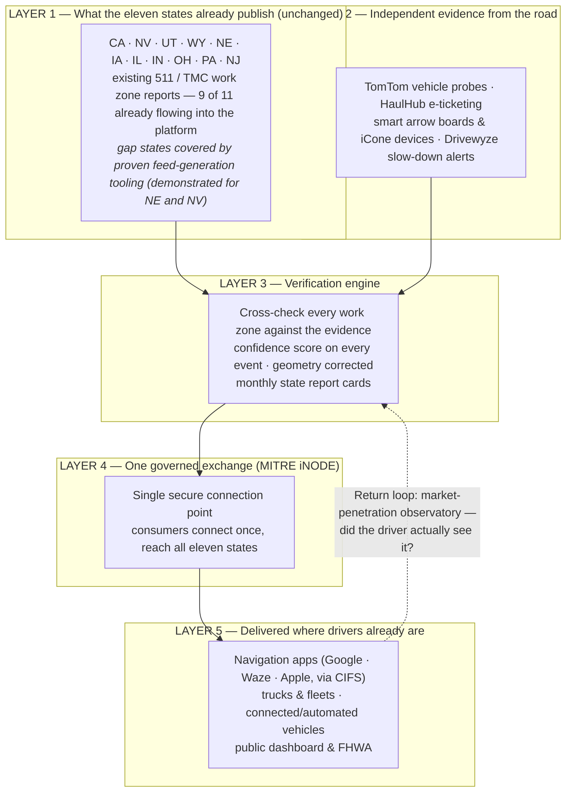

# I-80 Connected Work Zone Corridor — Architecture for Leadership

*Briefing exhibit for the FHWA ATTAIN application (FY25–26 NOFO). I-80
companion to `ATTAIN_ARCHITECTURE_LEADERSHIP.md` (I-35 version).*

## The idea in one sentence

Eleven states keep publishing exactly what they publish today; the project
layers independent evidence on top of those reports, verifies every work
zone, and delivers **one quality-scored feed** to every navigation app,
truck, and connected vehicle on America's transcontinental freight backbone —
through a single connection.

## How the data flows

## Why I-80 is ready for this

1. **Nine of eleven corridor states already flow into the platform today** —
   CA, NV, UT, NE, IA, IL, IN, OH, NJ (plus PA Turnpike), across WZDx, CARS,
   and custom formats.
2. **The two gap states are already solved in principle.** Nebraska and
   Nevada don't publish WZDx today, but tested Python generators produce
   conformant feeds from their existing data — the DIY kits are written and
   handoff-ready.
3. **The I-80 Corridor Coalition already convenes** — the platform hosts the
   coalition's shared calendar and progress tracking today, so governance has
   a running start.
4. **Freight stakes are national.** I-80 is the transcontinental backbone;
   winter closures and work zone conflicts in WY/NE/IA ripple coast to coast.
   Truck parking data (IL TPIMS, Iowa rest-area monitoring) is already live
   in the platform for this corridor.

## Why this architecture wins

1. **Almost nothing is asked of the states.** Quality is raised *above* the
   states, not demanded *from* them. Eleven states can say yes quickly; more
   can join later without renegotiating anything.
2. **Trust, measured in public.** Every event carries a confidence score;
   every state gets a monthly report card on a public dashboard.
3. **One connection instead of fifty.** Google, Waze, fleets, and AV
   developers connect once to the exchange and receive the whole corridor.
4. **Built on systems running today.** ~70 upstream sources, ~39 work zone
   feeds, quality scoring, and probe comparison are operational now. Grant
   funds deployment, not invention.

## What the grant buys (draft, 36 months)

| Deployment element | Total |
|---|---:|
| Connected work zone field systems (~40 zones/season, automated device-to-event linkage) | $6.0M |
| Standardized publication + geometry correction across all eleven states, incl. feed generation for non-publishing states | $2.5M |
| MITRE iNODE exchange backbone | $2.0M |
| Program management, systems engineering, governance | $1.5M |
| Verification engine, public dashboard & evaluation | $1.5M |
| Corridor bridge clearance intelligence (NBI + state GIS reconciliation) | $1.0M |
| Outreach, training & national transferability toolkit | $0.5M |
| **Total — $12M Federal (80%) / $3M non-Federal (20%, largely in-kind)** | **$15.0M** |

*Shareable rendered version (private link): claude.ai/code/artifact/12f8e79b-7599-4369-840b-d459b950bc58*
