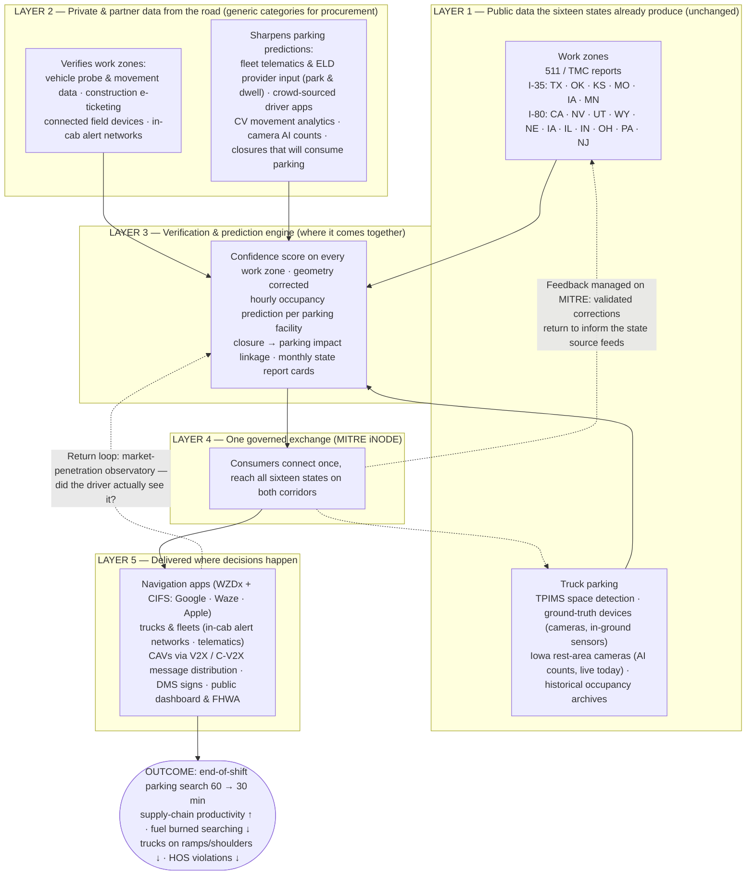

# Iowa-Led ATTAIN Application — Architecture for Leadership

*Briefing exhibit for the FHWA ATTAIN application (FY25–26 NOFO). Iowa DOT,
lead applicant, supporting CCAI year-one work plan, I-35 Anchor State
activities, and the I-80 Corridor Coalition — sixteen states, meeting at the
Iowa crossroads. Companion to `ATTAIN_I35_APPLICATION_DRAFT.md`.*

## The idea in one sentence

States keep publishing exactly what they publish today; the project brings
public and private data together, verifies every work zone, predicts parking
at every facility, and delivers one trusted feed to every navigation app,
truck, and connected vehicle on both corridors — so a driver ending a shift
finds a legal, safe spot in **30 minutes instead of 60**.

## How it comes together

**Why the work zone and parking halves need each other:** a work zone or
closure tonight will consume the next three truck stops' capacity. Because
both live in one engine, the system knows that — and tells drivers and
dispatchers — **before the shift ends**, not after the lot fills.

## Where specific partners fit (internal mapping — keep generic in the application)

Private-sector categories are stated generically in application materials for
procurement neutrality (2 CFR 200.319 competition rules); providers are
selected competitively after award. For internal planning, the market maps
as:

| Category (what the application says) | Layer | Market examples (illustrative, non-exclusive) |
|---|---|---|
| Vehicle probe & movement data | 2 (verify) | TomTom, Moove.AI |
| Construction e-ticketing | 2 (verify) | HaulHub |
| Connected field devices | 2 (verify) + 3 (deploy) | iCone, smart arrow board vendors |
| In-cab alert networks | 2 (verify) + 5 (deliver) | Drivewyze |
| Fleet telematics & ELD provider input (park & dwell, braking) | 2 (predict) | Geotab, Motive, Samsara |
| Crowd-sourced driver apps | 2 (predict) | Trucker Path |
| CV movement analytics | 2 (predict) | Moove.AI |
| Ground-truth devices (cameras, in-ground sensors) | 1 (public) + 3 (deploy) | Iowa rest-area camera AI (live); in-ground sensor vendors |
| Historical occupancy archives | 2 (predict) | Platform TPIMS history (already collected); state archives |
| V2X/TIM message distribution | 4–5 | Trihydro SDX (commercially operated — treat generically like the others, despite USDOT-sponsored origins) |

## Why this architecture wins

1. **Almost nothing is asked of the states.** Quality is raised *above* the
   states, not demanded *from* them — participation and a support letter, not
   new systems or staff.
2. **The goal is measurable with instruments already running.** Parking
   predictions are calibrated against observed counts today (including
   Iowa's rest-area camera AI); work zone accuracy is scored against
   independent evidence. The ATTAIN-required performance measurement plan is
   not a promise — it is running.
3. **One connection instead of fifty.** Google, Waze, fleets, and AV
   developers connect once to the exchange and receive the whole corridor.
4. **Built, not proposed.** ~70 upstream sources, ~39 work zone feeds,
   prediction and scoring engines operational now. Grant funds deployment.

## The headline number

| | |
|---|---|
| National baseline (ATRI driver diaries) | ~56 min/day searching for parking; ≈$5,000/yr lost wages per driver (~10% of pay) |
| Project goal | **Average end-of-shift search cut from 60 to 30 minutes** on the corridor |
| Downstream | Supply-chain resiliency ↑ · fuel efficiency ↑ · unsafe shoulder/ramp parking ↓ · HOS violations ↓ |

## What the grant buys (draft, 36 months)

| Deployment element | Total |
|---|---:|
| Truck parking availability + prediction network (public + private data, delivery to cab/dispatch/signs) | $2.5M |
| Connected work zone field systems (~40 zones/season, automated device-to-event linkage) | $4.5M |
| Standardized publication + geometry correction across all 16 corridor states | $2.0M |
| MITRE iNODE exchange backbone | $2.0M |
| Program management, systems engineering, governance | $1.5M |
| Verification & prediction engine, public dashboard & evaluation | $1.5M |
| Corridor bridge clearance intelligence (NBI + state GIS reconciliation) | $0.5M |
| Outreach, training & national transferability toolkit | $0.5M |
| **Total — $12M Federal (80%) / $3M non-Federal (20%, largely in-kind)** | **$15.0M** |

*Shareable rendered version (private link): claude.ai/code/artifact/138f2971-4ad7-458b-874b-cc84df9d547a*
